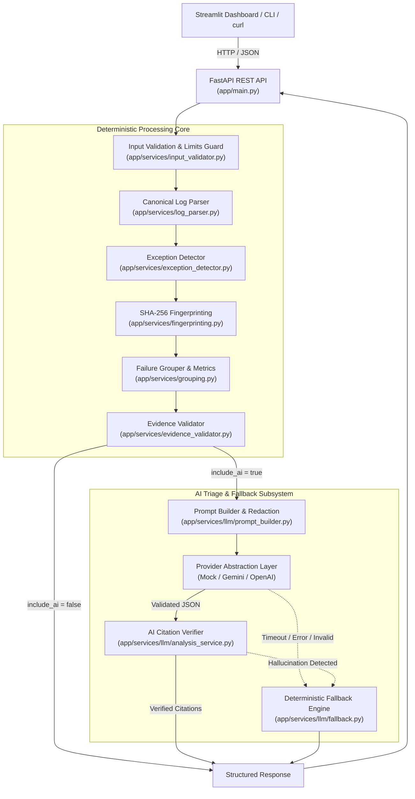

# LogLens AI — Intelligent Application Log Analysis

[](https://www.python.org/)
[](https://github.com/astral-sh/ruff)
[](https://docs.pytest.org/)


**LogLens AI** is an intelligent, high-reliability log analysis engine designed to help software engineers, SREs, and DevOps teams rapidly triage application and test logs. It parses multiline logs, isolates error events, extracts complete stack traces, clusters recurring failures via deterministic SHA-256 fingerprinting, and generates evidence-anchored root-cause hypotheses using LLMs (Google Gemini or OpenAI) with automatic, zero-downtime deterministic fallback.

The platform provides a strictly typed **FastAPI REST API** and an interactive **Streamlit Developer Console**.

---

## 1. Problem Statement

Debugging distributed microservices and automated test suites during outages presents several recurring challenges:

- **Alert Noise & Redundancy:** Hundreds of repeated error lines and cascading failures drown out the primary root cause.
- **Off-By-One Traceability Gaps:** Many log parsers lose line alignment, making it difficult to match summarized errors back to original log files.
- **Unverified AI Summaries:** Generic LLM assistants frequently hallucinate non-existent line numbers, invent ungrounded explanations, or leak confidential credentials passed in raw prompts.
- **Availability Risk:** Triage workflows that depend strictly on cloud AI services fail during provider outages or rate limits.

**LogLens AI** resolves these issues through a **deterministic-first, evidence-anchored architecture**:

1. All parsing, line mapping, fingerprinting, and grouping run deterministically in microseconds completely offline.
2. The LLM acts solely as a cognitive accelerator for high-level triage, never as a single point of failure.
3. Every cited line reference and excerpt is mathematically verified against the source text before presentation.
4. If the AI provider is disabled, unconfigured, or fails, the system automatically synthesizes a deterministic fallback report.

---

## 2. Key Features

- **Multiline Log & Stack Trace Parsing:** Preserves exact 1-based line numbering across blank lines and multiline Java (`Caused by:`, `... N more`, `Suppressed:`) and Python exception traces.
- **Deterministic SHA-256 Fingerprinting:** Normalizes volatile tokens (UUIDs, IP addresses, hex memory addresses) to cluster recurring failures into ranked groups.
- **Pre-Parse Input Validation:** Enforces exact boundaries: 1 MiB byte ceiling, 20,000 line limit, 16,384 character line length, and UTF-8 encoding guards.
- **Evidence Integrity Verification:** Cross-validates all failure occurrences, metrics, and excerpts against literal source lines.
- **Sandboxed LLM Triage:** Constructs bounded prompts with token/secret redaction (`sk-...`, Bearer tokens, passwords) and untrusted data sandboxing.
- **Instant Deterministic Fallback:** Automatically handles provider timeouts, 429 rate limits, 401 auth failures, and malformed JSON with reliable deterministic triage.
- **FastAPI REST API:** Full OpenAPI 3.1 documentation, correlation headers (`X-Request-ID`, `X-Process-Time`), and leak-free error envelopes.
- **Streamlit Web Console:** Interactive browser dashboard with file upload guards, failure group sorting, occurrence navigation, and color-coded source highlighting.
- **Automated Offline Test Suite:** 397 automated tests with 88% overall statement coverage, running 100% offline without live internet access or real API keys.

---

## 3. Technology Stack

| Component                      | Technologies & Frameworks                                              |
| :----------------------------- | :--------------------------------------------------------------------- |
| **Language & Runtime**         | Python 3.12 (compatible with 3.11+), dataclasses, asyncio, regex       |
| **Backend & REST API**         | FastAPI, Uvicorn (ASGI), Starlette CORS & Request Timing Middleware    |
| **Data Validation & Settings** | Pydantic v2, Pydantic-Settings, python-dotenv                          |
| **Frontend Console**           | Streamlit, Streamlit AppTest, custom CSS/HTML injection                |
| **AI Integration**             | Google Gemini API, OpenAI API, Provider Abstraction Layer              |
| **Testing & Quality**          | Pytest, Pytest-Cov (88% statement coverage), Ruff (Linter & Formatter) |
| **HTTP Clients**               | Requests                                                               |

---

## 4. Architecture Overview

LogLens AI cleanly separates client interfaces, API routing, deterministic core services, and optional LLM orchestration:



_For an in-depth component-level specification, see [`docs/architecture.md`](docs/architecture.md)._

---

## 5. Prerequisites

- **Python:** Version `3.11` or `3.12` installed.
- **Git:** For cloning the repository.
- **LLM Credentials (Optional):** Google Gemini API key or OpenAI API key.
  > [!NOTE]
  > An API key is **not required** for core deterministic log parsing, failure grouping, source-line viewing, or running automated tests.

---

## 6. Installation & Setup

```bash
# 1. Clone the repository
git clone https://github.com/your-username/LogLens-AI.git
cd LogLens-AI

# 2. Create and activate a Python virtual environment
python3 -m venv .venv
source .venv/bin/activate

# 3. Install dependencies
pip install --upgrade pip
pip install -r requirements.txt

# 4. (Optional) Configure environment variables
cp .env.example .env
```

---

## 7. Configuration Reference

All settings can be configured via environment variables or a `.env` file in the project root:

| Variable               | Default                 | Required | Description                                                    |
| :--------------------- | :---------------------- | :------: | :------------------------------------------------------------- |
| `APP_NAME`             | `"LogLens AI"`          |    No    | Application service name.                                      |
| `APP_ENV`              | `"development"`         |    No    | Deployment environment (`development`, `test`, `production`).  |
| `DEBUG`                | `false`                 |    No    | Enables verbose logging and relaxed CORS rules.                |
| `MAX_LOG_SIZE_BYTES`   | `1048576` (1 MiB)       |    No    | Strict byte ceiling for incoming log payloads.                 |
| `MAX_LOG_LINES`        | `20000`                 |    No    | Maximum accepted lines per submitted log.                      |
| `MAX_LOG_LINE_LENGTH`  | `16384`                 |    No    | Maximum accepted character length per individual line.         |
| `LOGLENS_API_URL`      | `http://127.0.0.1:8000` |    No    | Backend API URL used by the Streamlit frontend.                |
| `LLM_ENABLED`          | `false`                 |    No    | Master switch for AI triage requests. Set to `true` to enable. |
| `LLM_PROVIDER`         | `None`                  | Optional | Provider name: `"gemini"`, `"openai"`, or `"mock"`.            |
| `LLM_API_KEY`          | `None`                  | Optional | API key for Gemini or OpenAI (kept local; never committed).    |
| `LLM_MODEL`            | `None`                  | Optional | Custom model name (e.g. `gemini-1.5-flash`, `gpt-4o`).         |
| `LLM_TIMEOUT_SECONDS`  | `30.0`                  |    No    | Bounded HTTP timeout for model requests.                       |
| `LLM_MAX_PROMPT_CHARS` | `30000`                 |    No    | Character truncation boundary for model prompts.               |

> [!WARNING]
> Never commit `.env` or real API keys to version control. The repository's `.gitignore` automatically excludes all `.env` files.

---

## 8. Running the Application

### Option 1: Single-Command Startup (Recommended)

Starts both the FastAPI backend and the Streamlit dashboard, waiting for the health check before launching:

```bash
./run_app.sh
```

### Option 2: Individual Terminal Startup

**Terminal 1 — FastAPI Backend:**

```bash
source .venv/bin/activate
./run_backend.sh
# Or directly: uvicorn app.main:app --host 127.0.0.1 --port 8000 --reload
```

**Terminal 2 — Streamlit Dashboard:**

```bash
source .venv/bin/activate
./run_dashboard.sh
# Or directly: streamlit run frontend/streamlit_app.py
```

### Available Endpoints & Ports

- **Streamlit Web Console:** `http://localhost:8501`
- **FastAPI Base API:** `http://127.0.0.1:8000`
- **Liveness Probe:** `http://127.0.0.1:8000/health`
- **Readiness Probe:** `http://127.0.0.1:8000/health/ready`
- **Interactive Swagger UI:** `http://127.0.0.1:8000/docs`
- **Interactive ReDoc:** `http://127.0.0.1:8000/redoc`
- **OpenAPI JSON Spec:** `http://127.0.0.1:8000/openapi.json`

---

## 9. Quick Usage Walkthrough

1. Open `http://localhost:8501` in your browser.
2. In the left sidebar, choose **Input Mode** -> **Sample Logs**.
3. Select `recurring_failures.log` from the dropdown.
4. Leave **Request AI Assistance** checked or unchecked.
5. Click **🚀 Analyze Logs**.
6. Inspect the **Summary Metric Cards** (4 failure events, 2 recurring groups).
7. In the **Failure Groups** tab, click an occurrence to view its stack trace.
8. Switch to the **Source Line Viewer** tab to see exact lines highlighted (Red for failure lines, Orange for stack trace context).
9. If AI was requested without credentials, observe the **Deterministic Fallback Report** reporting full pattern insights with clear provenance.

_For detailed fixture walkthroughs, see [`docs/sample-walkthrough.md`](docs/sample-walkthrough.md)._

---

## 10. REST API Example

Analyze a log payload using `curl`:

```bash
curl -s -X POST http://127.0.0.1:8000/api/v1/analyze \
  -H "Content-Type: application/json" \
  -d '{
    "log_text": "2026-10-14 10:00:00 [ERROR] app.worker: DatabaseConnectionError: Lost connection to replica",
    "include_ai": false
  }' | jq .
```

_For comprehensive API documentation, error schemas, and sample outputs, see [`docs/api-examples.md`](docs/api-examples.md)._

---

## 11. Testing & Code Quality

The project features a **397-test automated test suite** running completely offline:

```bash
# Run all 397 automated tests
pytest

# Measure test coverage across application and frontend
pytest --cov=app --cov=frontend --cov-report=term-missing

# Run code style and lint checks
ruff check .

# Verify formatting without modifying files
ruff format --check .
```

### Verified Test Results

- **Pytest:** 397 passed in 4.17s (0 failures, 100% offline).
- **Code Coverage:** **88% Overall Statement Coverage** across `app` and `frontend`.
- **Ruff:** 0 errors; all 88 files formatted cleanly.

---

## 12. Security & Privacy Safeguards

- **Strict Boundary Limits:** Input validation protects the parser against denial-of-service via memory exhaustion or regex catastrophic backtracking.
- **Data Sandboxing:** Raw logs sent to the LLM are encapsulated in `<LOG_EVIDENCE>` blocks with explicit instructions preventing instruction injection.
- **Conservative Token Redaction:** API keys, Bearer tokens, passwords, and private key blocks are automatically redacted prior to model dispatch.
  > [!CAUTION]
  > Automatic redaction is a heuristic safety measure. Users should always inspect proprietary logs before transmitting them to third-party AI APIs.
- **Traceback Non-Disclosure:** Error handlers never return raw Python tracebacks, secrets, or internal server paths in client responses.

---

## 13. Known Limitations & Design Trade-offs

- **Single-Node Ingestion:** Optimized for payloads up to 1 MiB. Logs above 1 MiB are rejected to protect single-node memory budgets.
- **Format Specificity:** The parser is tailored for standard Python, Java, and JSON structured logs. Unstructured, non-standard syslog variants may trigger parser warnings.
- **AI Explanations as Hypotheses:** LLM recommendations are probabilistic hypotheses grounded by verified citations; they should always be validated by an engineer.

---

## 14. Project Structure

```text
LogCheck/
├── app/                              # FastAPI Backend & Core Engine
│   ├── api/                          # HTTP routes, error handlers, dependencies
│   ├── core/                         # Configuration (Settings), base exceptions
│   ├── models/                       # Pydantic models (entries, events, groups)
│   ├── services/                     # Parsers, fingerprinters, validators
│   │   └── llm/                      # AI orchestration, prompts, fallback, providers
│   ├── utils/                        # Line references & text helpers
│   └── main.py                       # FastAPI application factory
├── frontend/                         # Streamlit Web Console
│   ├── components/                   # UI components (metrics, groups, viewer)
│   ├── api_client.py                 # Decoupled HTTP API client
│   ├── streamlit_app.py              # Main dashboard entrypoint
│   └── utils.py                      # HTML formatting & styling helpers
├── docs/                             # Documentation & Portfolio Assets
│   ├── architecture.md               # Pipeline architecture & Mermaid diagram
│   ├── sample-walkthrough.md         # Reproducible fixture triage walkthrough
│   ├── api-examples.md               # REST API reference & curl examples
│   └── portfolio-description.md      # Resume bullets & interview talking points
├── tests/                            # Automated Offline Test Suite (397 tests)
│   ├── fixtures/                     # Test fixtures (.log files)
│   ├── asgi_client.py                # Offline ASGI test client
│   └── test_*.py                     # Unit, integration, and E2E test files
├── .env.example                      # Environment configuration template
├── pyproject.toml                    # Build metadata & tool configuration
├── requirements.txt                  # Direct runtime & development dependencies
├── run_app.sh                        # One-command startup script
├── run_backend.sh                    # Backend startup script
└── run_dashboard.sh                  # Frontend startup script
```

---

## License

This project is licensed under the **Creative Commons Attribution-NonCommercial-ShareAlike 4.0 International License (CC BY-NC-SA 4.0)**. See the [`LICENSE.md`](file:///home/swarnavo/Desktop/PROJECTS/SyncThreshold/LICENSE.md) file for complete terms.

## Contact

For questions or support, please open an issue or contact the maintainer at: swarnavokhanra@gmail.com

## Author & Generation Statement

This project was authored and is maintained by **Swarnavo Khanra**. The documentation for this repository was generated using the **GPT-5 mini** LLM model and has been manually reviewed and verified.

---
