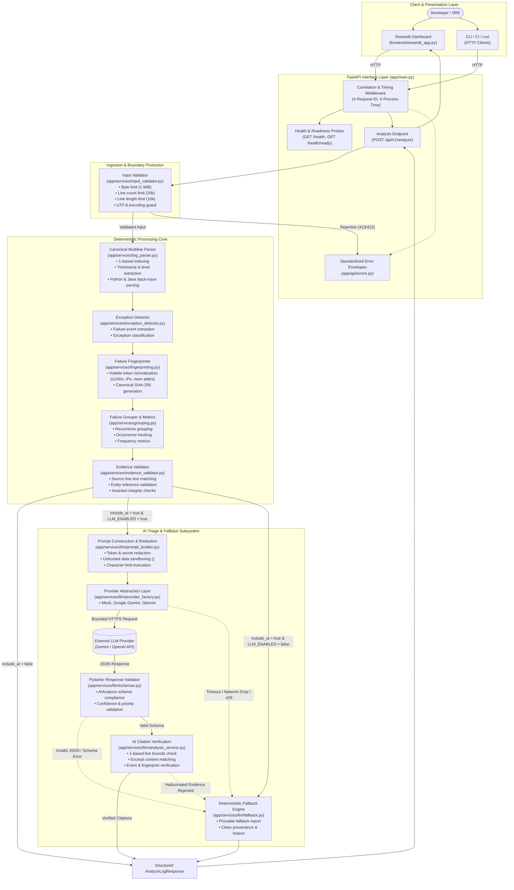

# Architecture & System Design — LogLens AI

LogLens AI is designed around a **deterministic-first, evidence-anchored architecture**. The system strictly decouples deterministic log ingestion, parsing, and failure clustering from optional LLM-assisted triage. This design ensures that core observability and incident diagnostics remain completely functional, fast, and reliable even when external AI providers are offline, rate-limited, or unconfigured.

---

## 1. System Pipeline Architecture

---

## 2. Core Architectural Pillars

### 1. Pre-Parse Boundary Protection

Untrusted logs enter through `app/services/input_validator.py` before hitting parsing routines:

- **Maximum Payload Size:** Strict 1 MiB boundary (`1,048,576` bytes). Payloads $\ge$ 1,048,577 bytes are rejected immediately with HTTP 413 `LOG_TOO_LARGE`.
- **Maximum Line Count:** Upper limit of 20,000 lines. Oversized logs are rejected with HTTP 413 `TOO_MANY_LOG_LINES`.
- **Maximum Line Length:** Upper limit of 16,384 characters per single line to avoid regex catastrophic backtracking (`LOG_LINE_TOO_LONG`).
- **Encoding Integrity:** Strictly rejects non-UTF-8 binary bytes with HTTP 422 `INVALID_ENCODING`.

### 2. Canonical 1-Based Line Indexing

To prevent off-by-one errors common in log parsers:

- Lines are split using universal newline rules (`splitlines()`), preserving empty lines and whitespace.
- Every parsed entry, failure event, stack frame, and AI citation maps to an immutable, 1-based source line index `[1, total_lines]`.

### 3. Volatile Token Normalization & SHA-256 Fingerprinting

To cluster identical root causes that manifest with variable diagnostic tokens:

- **Normalization:** Regex replacement filters out hex memory addresses (`0x7f8b9c0012a0`), UUIDs (`550e8400-e29b-41d4-a716-446655440000`), IPv4 addresses (`192.168.1.100`), thread IDs, and numeric request IDs.
- **Hashing:** A canonical string composed of `exception_type`, `normalized_message`, `top_stack_frame`, and `component` is hashed with SHA-256, generating a stable 64-character fingerprint.
- **Ordering:** Groups are stably sorted by `occurrence_count` descending, then `first_seen_line` ascending.

### 4. Evidence Integrity Verification

Before results leave the core, `app/services/evidence_validator.py` validates that:

- Every line number referenced actually exists in the source text.
- Every referenced excerpt matches the literal slice of that line.
- Aggregate metrics agree with underlying failure counts and group occurrences.

### 5. Sandboxed AI Triage & Deterministic Fallback

When AI analysis is requested (`include_ai: true`):

1. **Prompt Isolation:** Raw log lines are wrapped in `<LOG_EVIDENCE>` tags with strict system instructions treating logs as inert, untrusted diagnostic data.
2. **Secret Redaction:** API keys, Bearer tokens, passwords, and private key blocks are redacted prior to model dispatch.
3. **Citation Verification:** Every line number and excerpt cited by the LLM is checked against the raw log. Hallucinated lines trigger an immediate fallback.
4. **Deterministic Fallback:** If the LLM provider times out, drops connection, returns malformed JSON, violates the Pydantic schema, or cites hallucinated lines, LogLens AI automatically synthesizes a deterministic fallback report derived from the grouped failures, ensuring zero downtime.
